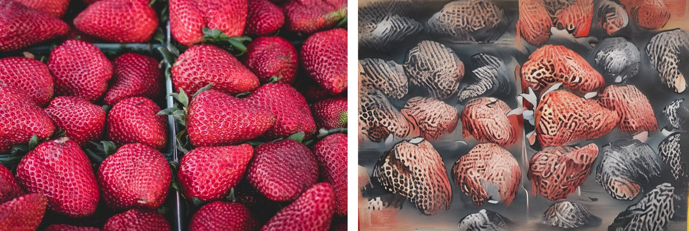

# CtrLoRA 照片风格重绘

基于 CtrLoRA 的计算机视觉结课项目：将照片重绘为水墨、油画、像素或写实风格，通过 1～2 个视觉条件保持结构、姿态或色调。提供 PyQt5 桌面端、Gradio 网页端和命令行入口，面向 8GB 显存进行 fp16 与 sliced attention 适配。

## 桌面功能

- 自动匹配风格底座的提示词、负向提示词和 CFG。
- Canny、深度、骨架、分割、线稿、调色板等 12 类条件注册，最多两个条件联合控制。
- 每张图片右上角支持放大预览和原尺寸保存，预览窗口支持缩放及 1:1 查看。
- 条件提取、模型加载、逐步绘制、图像解码阶段可视化；绘制百分比来自实际采样步数。



## 目录

```text
.
├── README.md                 # 项目入口
├── requirements.txt          # 桌面推理依赖入口
├── 启动桌面版.bat             # 优先启动本地已打包 EXE
├── docs/                     # 仅本地保留的资料，Git 忽略
├── examples/                 # 保留的示例输入与最终输出
└── ctrlora/
    ├── app/                  # Qt / Gradio 界面
    ├── core.py               # 与界面无关的推理引擎
    ├── conditions.py         # 条件与 LoRA 注册表
    ├── styles.py             # 风格预设
    ├── cldm/ ldm/ annotator/ # 模型及第三方预处理器，保留原依赖结构
    ├── configs/              # 模型配置
    ├── scripts/              # 训练、评估、辅助检查及 downloads 下载脚本
    ├── tests/                # 桌面功能回归检查
    ├── packaging/            # PyInstaller 配置及启动钩子
    ├── ckpts/                # 本地权重，Git 忽略
    └── dist/CtrLoRADesktop/   # 完整桌面发布包，Git 忽略
```

## 使用本地 EXE

双击根目录的 **启动桌面版.bat**，或打开 `ctrlora/dist/CtrLoRADesktop/CtrLoRADesktop.exe`。

请整体保留 `CtrLoRADesktop` 文件夹，程序依赖其中的 `_internal`、`configs`、`ckpts`、`annotator`、`hf-cache`。无需另装 Python；生成仍需要兼容的 NVIDIA 显卡和驱动。

## 从源码运行

以下命令在仓库根目录执行。当前机器已验证 Python 3.11、PyTorch 2.12 + CUDA 13.0、PyQt5 5.15；版本清单见 [推理依赖](ctrlora/requirements.txt)。

```powershell
conda create -n ctrlora python=3.11
conda activate ctrlora
python -m pip install torch==2.12.0 torchvision==0.27.0 --index-url https://download.pytorch.org/whl/cu130
python -m pip install -r requirements.txt
cd ctrlora
python app/qt_app.py
```

运行前将模型放到下表位置。GitHub 源码不包含这些大文件，本机已有文件已保留。

| 资源 | 相对仓库根目录的位置 |
| --- | --- |
| Base ControlNet | `ctrlora/ckpts/ctrlora-basecn/` |
| 条件 LoRA | `ctrlora/ckpts/ctrlora-loras/` |
| SD1.5 风格底座 | `ctrlora/ckpts/sd15/` |
| 预处理器权重 | `ctrlora/annotator/ckpts/` |

下载脚本在 [ctrlora/scripts/downloads](ctrlora/scripts/downloads)，可在 Bash 中运行。风格底座与原始权重来源见 [CtrLoRA 官方说明](https://github.com/xyfJASON/ctrlora)；脚本列出的风格文件并不涵盖所有历史手工下载模型。CLIP 文本编码器首次使用需要联网下载或准备已有缓存。

从 `ctrlora/` 目录运行其他入口：

```powershell
python app/gradio_style_transfer.py
python run_style_transfer.py --input ../examples/input_landscape.jpg --output results/output.png --condition1 canny --sd-file ckpts/sd15/ChineseInkComicStrip_v10.ckpt
```

## 检查与打包

```powershell
# 仓库根目录：检查文档链接与 Git 候选文件
python tools/check_repository.py

# 源码目录：桌面功能回归检查
cd ctrlora
python -m unittest discover -s tests -p test_desktop_features.py -v

# 安装打包依赖后构建桌面程序
python -m pip install -r packaging/requirements-build.txt
.\build_exe.bat
```

打包配置与操作见 [packaging/README](ctrlora/packaging/README.md)。本地 `docs/upstream/` 中另存有上游训练资料，其原始环境不与当前桌面推理环境混用。

## 文档与样例

- 报告、调研和开发记录仅保留在本地 `docs/`，不随 Git 仓库上传。
- [照片输入](examples/input_landscape.jpg) / [水墨输出](examples/output_ink.png)


## 来源与许可

CtrLoRA 原作者及原始代码许可保留于 [ctrlora/LICENSE](ctrlora/LICENSE)。第三方预处理器的许可证保留在对应源码目录。本项目新增代码仅供学习用途；风格模型的授权以各自来源为准。
