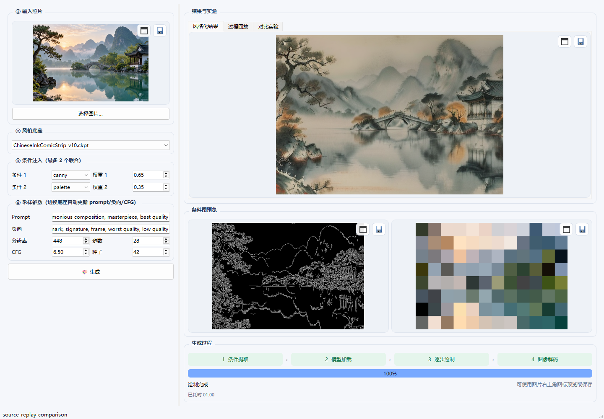
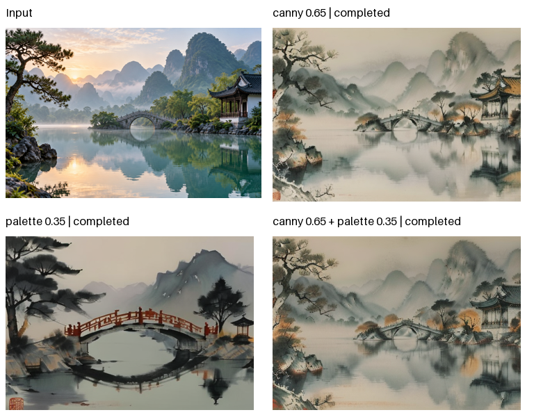

# A Simple Style Transfer · 可控照片风格重绘

基于 **CtrLoRA / Stable Diffusion 1.5** 的计算机视觉结课项目。将输入图像重绘成水墨、油画、像素或写实风格，通过视觉条件保留轮廓、空间结构或色调，并在桌面端查看生成过程与控制效果。

**当前版本：v0.2.0** · PyQt5 桌面端 · 真实采样回放 · 双条件对比实验 · 本地 GPU 推理

## 从山水场景到水墨作品

| 输入场景 | 本项目生成的水墨结果 |
| :---: | :---: |
|  |  |

输入为 AI 生成的山水建筑演示素材；右图由本仓库推理引擎实际生成。使用水墨底座、Canny + palette 双条件、固定随机种子。模型、提示词和采样设置见 [样例与复现参数](examples/README.md)，效果不代表所有图片与风格组合。

## 桌面工作台



左侧设置输入、风格与条件；右侧沿用原来的结果、条件图和阶段进度布局，在结果区域切换 **风格化结果 / 过程回放 / 对比实验**。

| 功能 | 当前实现 |
| --- | --- |
| 风格预设 | 按底座匹配提示词、负向提示词与 CFG；实际可选风格取决于本地模型 |
| 视觉条件 | 注册 Canny、深度、骨架、分割、线稿、调色板等 12 类条件，最多两个联合控制 |
| 图片操作 | 输入、结果与条件图支持放大预览、缩放、1:1 查看及原尺寸保存 |
| 阶段进度 | 区分条件提取、模型加载、采样、解码；绘制百分比来自实际采样步数 |
| 过程回放 | 间隔记录预测帧、拖动时间轴、播放/暂停、保存单帧及导出 GIF |
| 对比实验 | 真实 A 单条件、B 单条件、A+B 对照，以及 3×3 权重扫描 |
| 实验导出 | 拼图、原尺寸结果、条件图、输入图、参数 JSON 与结果 CSV |

## 看见生成过程


“过程回放”页默认记录生成过程，支持每 2 / 5 / 10 步采集预览。生成结束后可拖动时间轴、播放暂停或导出 GIF；每张预览也可单独保存。

这些帧是模型在不同采样阶段**对最终图像的预测**，不是画笔轨迹；最后一帧才是正式结果。GIF 使用固定播放节奏，不代表真实计算速度。请求步数与实际 DDIM 调度长度可能不同，界面按实际值显示。

## 看懂条件控制的作用



在相同输入、风格、提示词、种子和采样设置下，分别生成：

- **仅 Canny**：观察轮廓与构图约束。
- **仅 palette**：观察颜色分布约束。
- **Canny + palette**：观察两种条件联合后的表现。

单条件对照使用真实的单 LoRA 配置，不用双条件权重归零冒充单条件。另一方案“权重扫描”串行测试两个条件各 0.5 / 1.0 / 1.5 的 9 种组合，按 A 权重为行、B 权重为列排列。

实验期间固定参数并逐张生成；“停止后续任务”会等待当前图片完成。导出保留已完成项和失败/未运行状态。耗时包含预处理和模型加载，不用于纯采样速度排名；同种子也不意味着不同条件路径共享全部随机过程。

## 快速使用桌面版

本机已准备完整发布包时，双击根目录 **启动桌面版.bat**，或打开 `ctrlora/dist/CtrLoRADesktop/CtrLoRADesktop.exe`。

1. 导入图片并选择已安装的风格底座。
2. 选择条件；首次体验建议 `canny`，需要联合控制时将第二条件设为 `palette`。
3. 设置提示词、分辨率、步数和种子，点击“生成”。
4. 在“过程回放”页查看预测帧，或在“对比实验”页选择两个不同条件后开始 3 次 / 9 次实验。
5. 使用图片右上角的图标预览或保存；GIF 与实验包导出到自己选择的目录。

**请整体保留发布文件夹**：程序依赖其中的 `_internal`、`configs`、`ckpts`、`annotator` 和 `hf-cache`。GitHub 仓库不包含模型和 EXE；仅下载源码无法直接双击运行。EXE 无需另装 Python，生成仍需要兼容的 NVIDIA 显卡及驱动。

## 从源码运行

已在本机 Python 3.11、PyTorch 2.12 + CUDA 13.0、PyQt5 5.15 环境验证；依赖见 [requirements](ctrlora/requirements.txt)。安装命令中的 CUDA 版本需与自己的硬件和驱动相适配。

```powershell
# 仓库根目录
conda create -n ctrlora python=3.11
conda activate ctrlora
python -m pip install torch==2.12.0 torchvision==0.27.0 --index-url https://download.pytorch.org/whl/cu130
python -m pip install -r requirements.txt
cd ctrlora
python app/qt_app.py
```

运行前准备这些资源：

| 资源 | 相对仓库根目录的位置 |
| --- | --- |
| Base ControlNet | `ctrlora/ckpts/ctrlora-basecn/` |
| 条件 LoRA | `ctrlora/ckpts/ctrlora-loras/` |
| SD1.5 风格底座 | `ctrlora/ckpts/sd15/` |
| 预处理器权重 | `ctrlora/annotator/ckpts/` |
| CLIP 文本编码器 | Hugging Face 本地缓存；发布包使用 `hf-cache/` |

下载脚本在 [scripts/downloads](ctrlora/scripts/downloads)，可在 Bash 中运行。模型来源见 [CtrLoRA 官方说明](https://github.com/xyfJASON/ctrlora)；脚本不涵盖所有历史手工下载的风格底座。已有资源和缓存齐全时，桌面生成可离线运行。

网页与命令行入口仍可使用；本文的回放和实验交互主要面向桌面端：

```powershell
# ctrlora 目录
python app/gradio_style_transfer.py
python run_style_transfer.py --input ../examples/input_landscape.jpg --output results/output.png --condition1 canny --sd-file ckpts/sd15/ChineseInkComicStrip_v10.ckpt
```

## 项目结构

```text
.
├── README.md
├── requirements.txt
├── 启动桌面版.bat
├── examples/                 # 展示素材、真实生成样例与复现参数
├── docs/                     # 本地报告与资料，Git 忽略
└── ctrlora/
    ├── app/                  # 桌面 UI、回放/实验组件和工作线程
    ├── core.py               # 与界面无关的推理引擎
    ├── generation_records.py # 预览帧与实验记录
    ├── experiments.py        # 实验计划与串行队列
    ├── export_artifacts.py   # GIF、拼图、JSON、CSV 导出
    ├── conditions.py         # 条件注册与提取
    ├── styles.py             # 风格提示词预设
    ├── cldm/ ldm/ annotator/ # 模型与预处理器
    ├── configs/              # 推理配置
    ├── tests/                # 回归检查
    ├── packaging/            # PyInstaller 配置与使用说明
    ├── ckpts/                # 本地权重，Git 忽略
    └── dist/CtrLoRADesktop/   # 完整发布包，Git 忽略
```

## 验证与打包

```powershell
# 仓库根目录
python tools/check_repository.py

# ctrlora 目录：全部桌面/回放/实验/导出测试
cd ctrlora
python -m unittest discover -s tests -p "test_*.py" -v

# 完整桌面包
python -m pip install -r packaging/requirements-build.txt
.\build_exe.bat
```

v0.2.0 已完成 15 项单元测试、真实 GPU 生成、回放开关最终像素一致性、三项对比、九宫格和冻结 EXE 离线验证。实际验证主要覆盖水墨底座与 Canny + palette；12 类条件的注册不等于所有组合都已完成实机验证。面向 8GB 显存保留 fp16 与 sliced attention，实际需求取决于尺寸、长宽比和条件组合。

打包步骤见 [packaging/README](ctrlora/packaging/README.md)。报告、调研和开发记录仅保留在本地 `docs/`，不随 Git 仓库上传。

## 来源与许可

推理框架基于 [CtrLoRA](https://github.com/xyfJASON/ctrlora)，原作者和许可保留于 [LICENSE](ctrlora/LICENSE)。本项目主要完成桌面交互、推理适配、过程可视化、对比实验与部署集成。第三方预处理器及风格模型各自遵循原始许可；新增代码用于课程学习。
